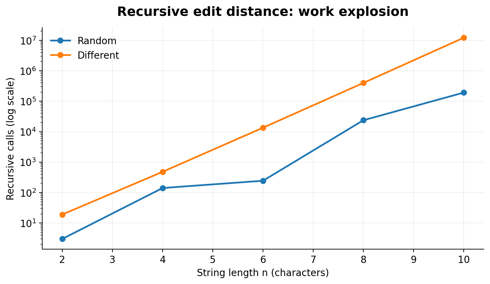
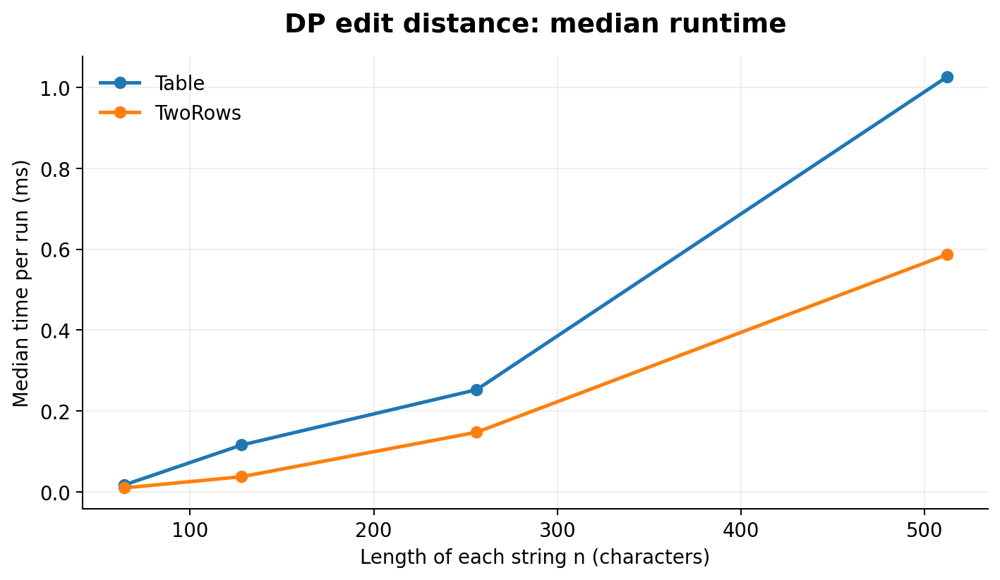
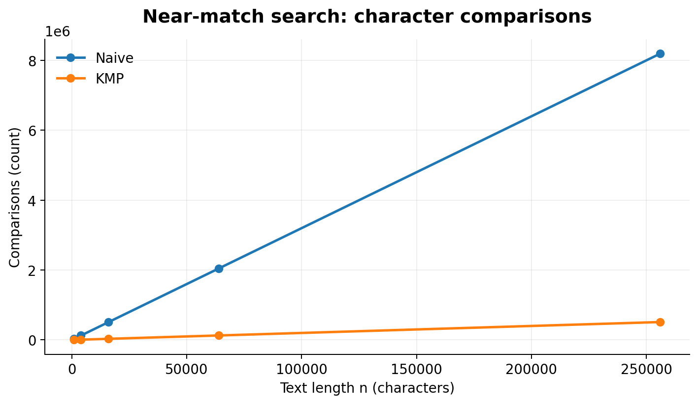
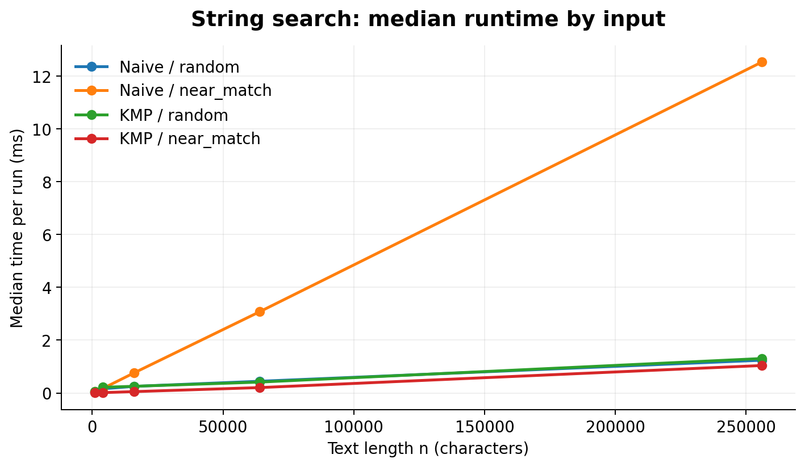

# Assignment 4 — Dynamic Programming and String Algorithms

**Project:** City Search & Spell-Check

## 1. Experiment Design Card

| Field | Edit Distance | String Search |
|---|---|---|
| Question | How does the performance of Recursive, Table and TwoRows change as string length increases? | How do Naive and KMP perform on random and difficult inputs? |
| Sizes | Recursive: 2, 4, 6, 8, 10. DP: 64, 128, 256, 512. | 1,000; 4,000; 16,000; 64,000; 256,000. |
| Inputs | Random strings and completely different strings. | Random text and near-matching text. |
| Metrics | Execution time (ms) and number of recursive calls or DP updates. | Execution time (ms) and character comparisons. |
| Prediction | Recursion will become very slow. Both DP methods will be faster, and TwoRows will save memory. | Naive will be slower on near-matching text. KMP will avoid repeated comparisons. |
| Plots | Recursive operations (log scale) and DP execution time. | Character comparisons and search execution time. |

The experiment uses a fixed random seed of **20261108**, making the generated inputs reproducible. Each combination was measured five times after a warm-up run. Median execution times are used in the graphs.

## 2. Implementation

### Edit Distance

Three versions were implemented:

- **Recursive:** Uses direct recursion without saving previous results. It has exponential worst-case time complexity.
- **Table:** Uses a complete dynamic programming table. Time complexity is O(n × m), and space complexity is O(n × m).
- **TwoRows:** Uses only two rows of the DP table. Time complexity is O(n × m), and extra space complexity is O(min(n, m)).

All three versions calculate the minimum number of insertions, deletions and replacements needed to transform one string into another.

### String Search

Two algorithms were implemented:

- **Naive Search:** Checks each possible starting position. Its worst-case time complexity is O(n × m).
- **KMP Search:** Uses the LPS array to avoid repeated comparisons. Its time complexity is O(n + m).

Both methods return all matching positions, including overlapping matches.

## 3. Plots and Results

### Plot 1 — Recursive Edit Distance Operations

**Takeaway:** Recursive calls grow very quickly. For completely different strings of length 10, recursion performed 12,146,179 calls.

### Plot 2 — Dynamic Programming Execution Time

**Takeaway:** Both Table and TwoRows performed 262,144 DP updates at n = 512. TwoRows was faster in the measured different-string case.

### Plot 3 — Naive vs KMP Character Comparisons

**Takeaway:** At n = 256,000 on near-matching input, Naive performed 8,191,008 comparisons, while KMP performed only 512,030.

### Plot 4 — String Search Execution Time

**Takeaway:** On the largest near-matching input, Naive required 12.5382 ms, while KMP required 1.0400 ms.

## 4. Prediction vs Result

### Edit Distance

I expected recursion to become much slower as the input size increased. The experiment confirmed this prediction because recursive calls increased rapidly. Both DP algorithms performed a predictable number of operations. TwoRows also required much less memory than Table.

### String Search

I expected KMP to perform better on difficult inputs. The experiment confirmed that Naive repeats many comparisons when the pattern almost matches the text. KMP avoids these repeated checks by using the LPS array. On random inputs, the difference was smaller.

## 5. Short Answers

### 1. Which input made string search slowest, and why?

The near-matching input made Naive Search the slowest. The text contained repeated `a` characters, while the pattern ended with `b`. Naive compared almost the entire pattern at each starting position. This caused millions of repeated comparisons.

### 2. How large an n could recursive Edit Distance handle, and what stopped it?

I tested Recursive Edit Distance with input sizes up to n = 10. At this size, the different-string input required 12,146,179 recursive calls. The algorithm repeatedly solves the same subproblems. Because its work grows very quickly, I did not use larger sizes in the experiment.

### 3. What do you gain and lose when using two rows?

TwoRows uses much less memory than the full DP table. It keeps only two rows instead of storing every calculated value. Both versions have O(n × m) time complexity and return the same distance. However, TwoRows does not keep the complete table needed to easily reconstruct the sequence of edits.

### 4. Which string search would you choose for the city platform?

I would choose KMP for searching long log files. It uses the LPS array to avoid repeated comparisons. The experiment showed that KMP performed much better on near-matching inputs. It is a reliable choice for searching large texts.

## 6. Time Measurements

Execution time was measured in milliseconds using `System.nanoTime()`. Each test was repeated five times, and the median was used to compare performance. Time measurements can change because of the computer, JVM and background processes. Therefore, operation counters were also recorded to support the conclusions.

## 7. Testing

JUnit 5 was used to check the algorithms. The tests included reference values, empty strings, overlapping matches and 100 random comparisons for each algorithm family.

**Result: All 7 JUnit tests passed.**

The experiment generated 230 measurements and saved them in `results/results.csv`.

## 8. Conclusion

The experiment demonstrated the advantages of dynamic programming and efficient string matching. Recursive Edit Distance becomes expensive because it repeats calculations. Table and TwoRows avoid this problem, while TwoRows uses less memory. KMP performs better than Naive Search on difficult inputs because it avoids unnecessary comparisons.

For the city platform, I would use TwoRows for spell-checking and KMP for searching long log files.